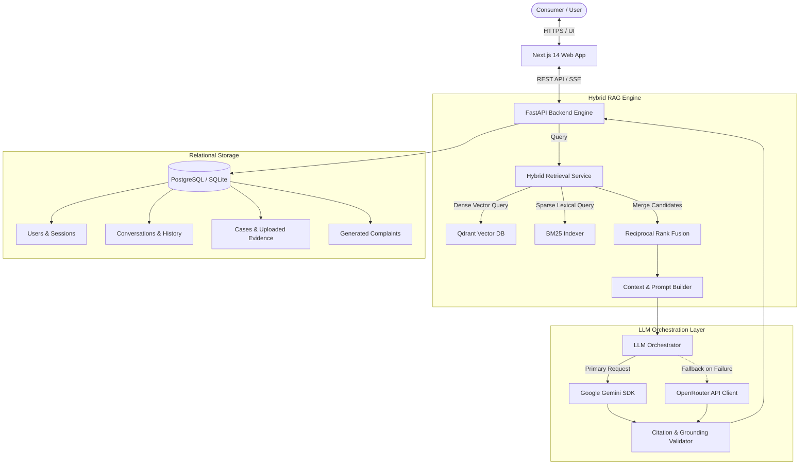

# NyayaSaathi AI — System Architecture & Design Specification

## 1. Architectural Philosophy
NyayaSaathi AI is designed around three foundational principles:
1. **Zero Legal Hallucination**: Every substantive claim regarding statutory rights, limitation periods, forum jurisdiction, or duties of e-commerce entities must trace back directly to an ingested official statutory passage.
2. **Resilience & Fallback**: Network operations, LLM inferences, and vector retrievals are designed with circuit-breaker patterns, timeout management, and seamless multi-provider fallback (Google Gemini to OpenRouter).
3. **Data Privacy by Architecture**: User grievance evidence (receipts, transaction screenshots, correspondence) is processed in isolated staging environments and never committed to the public vector index.

---

## 2. High-Level Component Topology

---

## 3. Core Subsystems

### 3.1 Next.js Frontend (`/frontend`)
- **App Router Architecture**: Modular routing using React Server Components and interactive client components.
- **Key Modules**:
  - `assistant/`: Interactive multi-turn chat with streaming legal advisory and dynamic source attribution cards.
  - `knowledge-base/`: Full-text and semantic search explorer for official Indian gazettes and acts.
  - `complaint-studio/`: Interactive legal complaint drafting wizard with field validation, section linking, and PDF generation.
  - `case/`: Case file manager allowing upload and automated analysis of invoices, emails, and dispute evidence.
  - `admin/`: Operational dashboard for index status, vector diagnostics, and evaluation metrics.

### 3.2 FastAPI Backend (`/backend`)
- **Asynchronous Execution**: Fully async endpoints utilizing `httpx` and `asyncio`.
- **Relational Persistence**: SQLAlchemy 2.0 with connection pooling, declarative models, and support for PostgreSQL in containerized environments with zero-config local SQLite fallback.
- **Pydantic Validation**: Strict schema enforcement for all incoming payloads and LLM JSON outputs.

### 3.3 Vector & Lexical Storage
- **Qdrant**: Primary vector database storing 384-dimensional dense vectors generated by `intfloat/multilingual-e5-small`.
- **BM25 Inverted Index**: In-memory and persistent BM25 engine indexing normalized legal tokens to preserve exact statutory citations (e.g., "Section 35(1)(a)", "Rule 5(3)(b)").
- **Reciprocal Rank Fusion (RRF)**: Merges dense and sparse rankings with configurable smoothing parameter k = 60.
