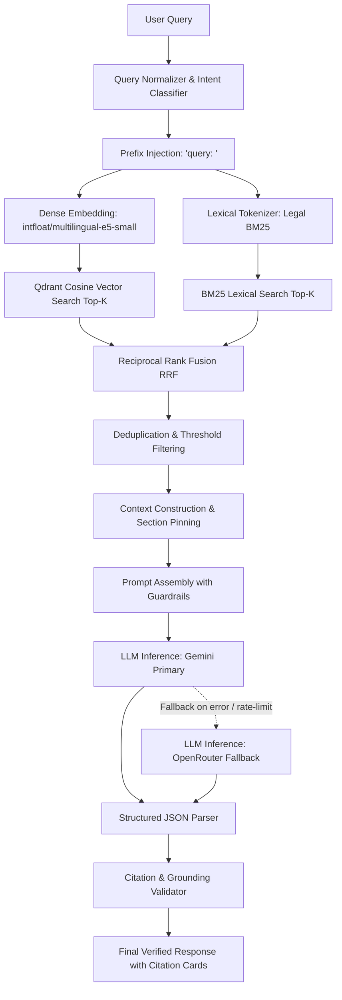

# NyayaSaathi AI — RAG Pipeline Specification

## 1. End-to-End Retrieval & Generation Workflow



---

## 2. Document Processing & Ingestion

### 2.1 Extraction
- Native PDF extraction via **PyMuPDF (`fitz`)**, preserving page boundaries, running headers, and legal indentation.
- HTML processing via **BeautifulSoup4**, extracting tables, statutory definitions, and gazette notifications.

### 2.2 Legal-Aware Structural Detection
Indian legal statutes follow a strict hierarchical structure:
```
Act / Rules
 └── Chapter / Part
      └── Section / Rule
           └── Subsection / Sub-rule
                └── Clause / Proviso / Explanation
```
The ingestion pipeline detects regex patterns for:
- `CHAPTER\s+[IVXLCDM\d]+`
- `Section\s+\d+[A-Z]?`
- `Rule\s+\d+[A-Z]?`
- `Provided that...`
- `Explanation.—`

### 2.3 Semantic Parent-Child Chunking
- **Target Size**: 450–600 tokens
- **Max Chunk Size**: 750 tokens
- **Overlap**: 60–80 tokens
- **Integrity**: Chunks are never split mid-sentence or across isolated sub-clauses unless the sub-clause itself exceeds max chunk bounds.
- **Prefix Rule**: All passages are prefixed with `passage: ` prior to embedding calculation in accordance with `multilingual-e5-small` requirements.

---

## 3. Hybrid Retrieval & Rank Fusion (RRF)

Dense vector search is excellent at conceptual similarity. However, it often misses exact statutory numbers (e.g., "Section 86 liability"). BM25 ensures exact section number matching.

### Reciprocal Rank Fusion Formula:
RRF_Score(d) = sum_{m in M} 1 / (k + r_m(d))
Where:
- M = {Dense Vector Retrieval, BM25 Lexical Retrieval}
- k = 60 (smoothing constant)
- r_m(d) is the rank position of document d in system m.

---

## 4. Citation Validation Protocol
Before presenting any answer to the user:
1. Every citation tag (e.g., `[CHUNK_CPA2019_SEC35_01]`) emitted by the LLM is inspected.
2. The validator verifies that the cited ID exists in the retrieved context set.
3. If an LLM fabricates a chunk ID or quotes text not found in the source passage, the citation is flagged as ungrounded.
